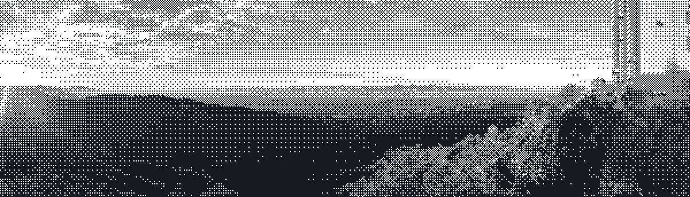

Mt Umunhum, <a href="https://maps.app.goo.gl/6FWxVJk4RoagVWzd6"> <em><ins> 37.1605&deg; N 121.8986&deg; W</ins></em></a>

# Alex Gao

Member of Technical Staff intern @Hypercubic (YC F25)  
prev. @IBM @Bloomberg 
building [Signalor](https://signalor.app) 
🥇 Gold, British Informatics Olympiad 
🥇 2× Gold, British Mathematical Olympiad I 
🥈 Silver, British Algorithmic Olympiad 
6× hackathon winner: YCxBrowserUse · SDxAnthropic · SDxVercel · DS3xBowCapital etc.. 

I have two career principles:
I want to build things that people use.
I yearn to span the knowledge space in its broadest definition.
Those two principles guide my professional career, and I have and will continuously work towards that.

## Stack

<!-- generated by scripts/make_badges.py -->

**Languages**  
              

**Frameworks**  
               

**Data & infrastructure**  
                 

**ML, data & robotics**  
                

**Automation & tooling**  
           

## Stuff I built

| Project | What it is | Result |
|---|---|---|
| **[Signalor](https://signalor.app)** | Public-sentiment intelligence for brands and investment firms | Sentiment **led Apple's YoY revenue growth by a quarter** on held-out data (r = 0.43) |
| **[Outcast Virus](https://devpost.com/software/outcast-virus)** | Autonomy OS for drone and ground-vehicle swarms | **1st place**, DS3 × Bow Capital: $4k, then a **$100k offer** to continue |
| **[awesome-reverse-engineered](https://github.com/alexgaoth/awesome-reverse-engineered)** | Searchable index of open-source tools built by reverse engineering closed apps, APIs, devices and file formats | **1,100+ stars**, **17,000+ projects** indexed and refreshed nightly ([search](https://awesome.alexgaoth.com)) |
| **[ferrodoc](https://github.com/alexgaoth/ferrodoc)** | Pandoc-compatible document converter in Rust | **72× faster** than pandoc on 10,000 DOCX, **47/48** command lines byte-identical |
| **[dont-hallucinate](https://pypi.org/project/dont-hallucinate/)** | Shell guardrail for coding agents | **500+ downloads** on PyPI and npm |
| **[weighted_map](https://github.com/alexgaoth/weighted_map)** | The contiguous US redrawn so distance is travel time | **253 origins**, drive or fly, orbitable in 3-D ([live](https://cool-maps.vercel.app)) |

More: **[alexgaoth.com/projects](https://alexgaoth.com/projects)**

## Commits

---

🌐 [alexgaoth.com](https://alexgaoth.com) · [LinkedIn](https://linkedin.com/in/alexgaoth) · [X](https://x.com/alexgaoth) · ✉️ alexgaoth@gmail.com
